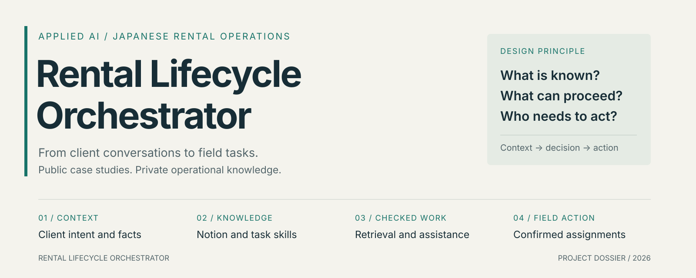
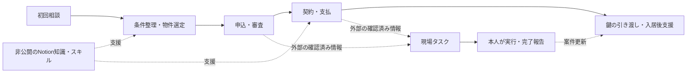

<a href="README.md">English</a> · 日本語 · <a href="README.zh-CN.md">中文详解</a>

# Rental Lifecycle Orchestrator

**問い合わせから鍵の引き渡しまで、賃貸業務の顧客対応をAIで支援する。**

非公開の業務知識、デスクトップ上の文脈、再利用可能なタスクスキル、顧客ライフサイクルの設計を結び付ける実務起点のプロジェクトです。

私は約**4年間**賃貸業務に携わり、初回相談から鍵の引き渡し、その後の支援まで、累計**300件以上の成約顧客**を一貫して担当してきました。年数と件数は本人による概算であり、AIが対応した実績件数を表すものではありません。

この経験から、本プロジェクトでは「不足している情報は何か」「何が確認済みか」「次に進める条件は何か」「人が動く必要があるのはいつか」を扱います。

## 目指す業務の形

顧客との会話から次の対応を定め、確認済みの業務イベントから必要な作業につなげます。長期的には、定型的な対話、条件収集、書類準備、進捗整理をシステムが担い、人には電話確認、訪問、署名、鍵の受け取り、例外対応などの具体的なタスクを渡すことを目指しています。

例えば、契約書の到着はイベントです。訪問日時、場所、前提条件が確認されて初めて、実行可能な予定になります。実務上必要なのは、作業内容と完了報告が明確なタスクです。

実際の業務フロー、文書作成の手順、[Jev](https://github.com/jev-chat/jev-chat-jarvis-mac) を基にした非公開の賃貸向け拡張が、現在の基盤です。本リポジトリでは選定した事例と技術上の判断を公開し、業務知識と実装は非公開で管理します。

## 現在の資産と確認範囲

| 資産 | 確認できる内容 | ライフサイクルでの役割 |
|---|---|---|
| 非公開のNotion業務知識 | 業者向け・顧客向けフロー、定型文、保管・引き渡し手順 | 段階、引き継ぎ、繰り返す説明の管理元 |
| 5種類のタスクスキル | 契約の中国語説明、費用概算、費用請求書、物件確認、大学キャンパス別検索 | 各段階の作業と確認方法の定型化 |
| 顧客向け文書 | 契約説明・費用文書と、その改訂版 | 設計の背景にある実務上の成果物 |
| 非公開のJev拡張 | ソース、インストール済みファイルとの比較、分野別テスト | 必要時の文脈取得、語句による検索、返信候補の制約 |
| 日付付きの検証 | **2026-10-21に選定した27件のオフラインテストが成功**。合成入力による5件の関数チェックも記録 | 対象モジュールに限定した根拠 |
| ライフサイクル・現場タスクの編排 | 本リポジトリの設計事例 | 継続的な状態管理、イベント処理、タスク割り当ての方向性 |

自動送信や全工程の継続的な自律運用は開発の目標です。今回のテストが確認した範囲は[検証記録](docs/verification.md)に記載しています。

## 会話から行動まで

*ライフサイクル設計の模式図です。自律運用中のシステムを記録したものではありません。*

## 3つの事例

1. **メッセージから、次に確認すべきことを導く。** 入居日の年が不明な場合は確認を残し、現在の段階に関係のない書類要求を持ち込まない。
2. **イベントから現場タスクを作る。** 契約の予定や鍵の受け取りに、日時、場所、前提条件、完了報告を対応させる。確認不足なら保留にする。
3. **シーズンの経験を次の業務へ戻す。** 問題が繰り返された場合はまずNotionを更新し、固定化できる対応を定型文やスキルへ反映する。

[事例の詳細 →](docs/case-studies.md)

## 技術上の判断

技術的には、**業務特化の検索拡張プロンプティング、決定的な検証、イベント駆動のワークフロー編排**を扱っています。前二者は既存モジュール、編排層は今後の設計です。

| 技術概念 | 本プロジェクトでの具体的な役割 | 状態 |
|---|---|---|
| **Lexical RAG／検索拡張プロンプティング** | 条件分岐とCJK文字bigram・語句の重なりによる検索で、出典付き知識を生成の文脈へ渡す | 非公開拡張に実装 |
| **プロンプト上の文脈分離とグラウンディング** | 業務参考と顧客の観測情報を区別し、参考文だけで案件の事実を確定しない | 指示として実装。完全なセキュリティ境界ではない |
| **決定的な検証とヒューリスティックなガードレール** | カレンダー検証と一部の文面パターンの検査 | 実装済み。選定したオフラインテストで確認 |
| **取得時間を限定したデスクトップ文脈取得** | ネイティブのホットキー登録で取得を開始し、出力では前面アプリの変更を考慮 | Jev上の適応として実装 |
| **ガード付き状態遷移と永続的な案件状態** | 生成文ではなく確認済みイベントを段階遷移の根拠にする | 編排層の設計 |
| **冪等なタスク割り当てと古いタスクの無効化** | 重複通知による二重割り当てを防ぎ、予定変更時は以前の時刻を無効にする | 今後の受け入れ条件 |

**業務知識と案件の事実を分ける。** 定型文に「入金済み」と書かれていても、その顧客の入金を証明するものではありません。検索で得た参考情報と、顧客について確認した内容を区別します。

**文脈取得のタイミングを限定する。** 非公開のJev拡張は、登録したホットキーで一定時間の取得を開始します。現在の出力は本人が確認して扱います。画面だけでは電話、別端末、未表示の履歴を把握できないため、継続的な案件状態は別の課題として設計します。

**現在の質問に合う知識を取得する。** 条件分岐と語句の照合を組み合わせ、出典付きのローカルスナップショットから検索します。現在の実装にはベクトルデータベースや専用モデルの学習を前提としていません。

**候補、事実、実行を区別する。** モデルの提案だけで案件の段階を進めず、確認済みイベントと前提条件を扱います。永続的な状態管理と自動割り当ては、今後の編排層で扱う中心課題です。

**ツールの役割を定める。** Notionは知識の管理元、Skillは確認可能な作業の定義、Jevはデスクトップの入口、Ollamaはローカル推論を担当します。将来の個人代理・デスクトップ代理ツールにも、状態管理と実行結果の確認が必要です。

[アーキテクチャ](docs/architecture.md) · [選定理由と今後の候補](docs/tooling-decisions.md)

## 担当した範囲

私の担当は、賃貸業務のモデル化、段階別の知識整理、文書・物件確認のスキル化、およびJevの分野別適応です。拡張では必要時の取得、知識検索、日付確認、一部の根拠のない断言への対処、出力と前面アプリの状態に関する確認を扱っています。

Jevの画面取得とUI、Ollamaと設定済みモデルの推論、NotionとCodexのプラットフォーム機能は上流の能力です。独自の業務設計・適応と区別して出典を明示します。

## シーズンごとの更新

主な繁忙期は**1〜4月**です。終了後にNotionのフローと頻出の定型文を微調整し、業務上必要なら小紅書など中国語メディア向けの物件・生活情報リストを作成します。

**9月**は小規模で、主に海外審査を利用する留学生が対象です。実際に発生した問題を小さく修正します。

[更新方法](docs/seasonal-maintenance.md) · [変更履歴](CHANGELOG.md)

詳細資料：[検証記録](docs/verification.md) · [公開範囲・出典・権利](docs/provenance-and-rights.md)

公開する顧客の状況とタスクカードはすべて合成例です。顧客記録、スキル全文、営業用テンプレートは配布しません。
