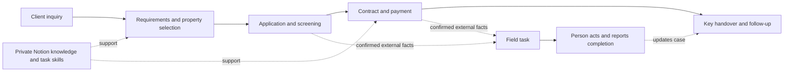
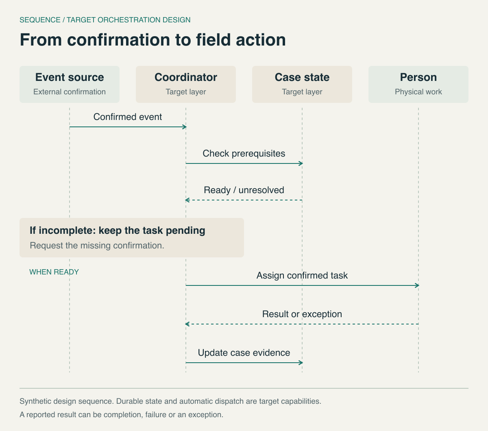

English · <a href="README.ja.md">日本語</a> · <a href="README.zh-CN.md">中文详解</a>

# Rental Lifecycle Orchestrator

**AI-assisted client operations, from first inquiry to key handover.**

A field-informed project connecting private operational knowledge, desktop context, reusable task skills and client lifecycle design in Japanese rental services.

I have approximately **four years of rental-service experience** and have personally handled **300+ completed client engagements**, from initial contact through key handover and subsequent support. These are my own career estimates; they describe my business experience, not the number of clients served by an AI system.

That experience supplies the questions behind this project: What information is missing? What is confirmed? What can proceed? When does a person actually need to act?

## The operating idea

A client conversation should lead to a clear next step. A confirmed business event should lead to the right work. The long-term direction is to let the system handle routine dialogue, information collection, document preparation and progress coordination, while a person receives concrete assignments for calls, appointments, signatures, key collection and exceptions.

For example, a contract arriving is an event. An appointment becomes actionable only after its time, location and prerequisites are confirmed. The useful output is a field task with a completion report, rather than another message to remember.

The project grows out of operating procedures and document work already used in my practice, together with a private rental-specific extension of [Jev](https://github.com/jev-chat/jev-chat-jarvis-mac). This repository publishes selected case studies and engineering decisions. The domain knowledge and implementation remain private.

## Problem formulation

Rental coordination is a partially observable, long-running process. A single case spans client conversations, property information, management-company responses, document revisions and physical handoffs. The person coordinating it repeatedly reconstructs what has happened and what is still missing. A fluent response helps with communication, but the operating problem also includes state, timing and responsibility.

Three boundaries shape the technical design. First, general operating knowledge changes more slowly than the facts of an individual case. Second, information received through a screen is an observation with limited coverage. Third, the cost of an incorrect action differs from the cost of an imperfect draft: asking an unnecessary question and arranging an unconfirmed visit have different consequences.

The project therefore treats **knowledge retrieval, case-state interpretation and action readiness** as separate concerns. A stage can guide which references to retrieve without proving that all of its prerequisites are satisfied. A document can be prepared before it is ready for delivery. A task can be proposed before it is safe to schedule. These distinctions determine the module boundaries.

| Operational friction | Engineering response |
|---|---|
| Repeated explanations with small contextual differences | Maintain a knowledge source and retrieve for the current question |
| Relevant information scattered across time and channels | Design durable, source-aware case state with unresolved facts |
| A convincing draft implies more certainty than the evidence supports | Apply deterministic checks and keep draft, fact and action distinct |
| A person must continually remember the next physical step | Define event-to-task transitions with prerequisites and completion reports |

## What exists today

| Asset | Current evidence | Role in the lifecycle |
|---|---|---|
| Private Notion operating knowledge | Operator and client procedures, phrase library, filing and handover guidance | A maintained source for stages, handoffs and recurring explanations |
| Five task skills | Contract explanation, cost estimation, cost requests, listing screening and campus-oriented search | Repeatable work at particular stages, with explicit checks |
| Client-facing document work | Existing contract-explanation and cost-document outputs, including revisions | Practical deliverables behind the workflow design |
| Private Jev extension | Inspectable source, installed-file comparison and domain tests | On-demand context, lexical retrieval and constrained reply assistance |
| Dated verification | **27 selected offline tests passed on 2026-10-21**; five synthetic function checks recorded | Evidence about specific modules, with a stated test boundary |
| Lifecycle and field-task orchestration | Design cases in this repository | The direction for persistent state, event handling and task dispatch |

Read the [verification record](docs/verification.md) for exactly what was exercised. Automatic sending and continuous end-to-end lifecycle operation are development goals, not claims established by these tests.

## From conversation to action

*Lifecycle design schematic. The diagram describes the intended coordination model; it is not a recording of a deployed autonomous workflow.*

## Three cases to explore

1. **A message becomes a useful next question.** A move-in date without a year remains unresolved. Stage-aware context should help clarify it, without introducing unrelated paperwork.
2. **An event becomes a field assignment.** A confirmed appointment or key-release notice produces a task with a time, place, prerequisites and completion report. Missing confirmation keeps the task pending.
3. **Seasonal experience improves the next cycle.** Repeated issues update Notion first; stable recurring actions become phrases or skill changes. Selected public checklists can support the next acquisition cycle.

[Read the three cases →](docs/case-studies.md)

*An orchestration design sequence using synthetic events. A task is proposed only after its prerequisites; the person reports what actually happened.*

## Engineering choices worth discussing

The technical framing is **domain-specific retrieval-augmented prompting, deterministic validation and event-driven workflow orchestration**. The first two describe implemented modules; orchestration is the next architectural layer.

| Technical concept | Concrete use here | Status |
|---|---|---|
| **Lexical RAG / retrieval-augmented prompting** | Conditional routing plus CJK bigram and token-overlap retrieval supplies source-linked context to generation | Implemented in the private extension |
| **Prompt-level context isolation and grounding** | Business references and client observations have distinct roles; a reference cannot establish a case fact | Implemented context instructions; not a complete security boundary |
| **Deterministic validation and heuristic guardrails** | Calendar checks and selected text-pattern checks run around model output | Implemented with selected offline coverage |
| **Bounded desktop context acquisition** | Native hotkey registration opens a limited capture request; the output path accounts for foreground changes | Implemented adaptation on Jev |
| **Guarded state transitions and durable case state** | Confirmed events, rather than generated text, determine whether a lifecycle stage can advance | Orchestration design |
| **Idempotent task dispatch and stale-task invalidation** | Duplicate notices should create one task; a changed appointment should invalidate the old schedule | Target acceptance behavior |

**Separate reference knowledge from case facts.** A template that says “payment received” explains a situation; it is not evidence that this client paid. Retrieved knowledge and observed client context must keep distinct roles.

**Capture deliberately.** The private Jev mode uses a registered hotkey and a bounded capture window. Its output remains under manual control. A screen observation covers only visible context; phone calls, other devices and unopened history require another source of case state.

**Retrieve for the current question.** The extension combines conditional routing with lexical matching over a private, source-linked snapshot. It does not require a vector database or training a domain model. This keeps the implemented mechanism inspectable and the maintenance work limited.

**Treat a draft, a fact and an action differently.** A model suggestion should not advance the case by itself. Event-driven state and action prerequisites are central design concerns for the next orchestration layer.

**Choose the tool for its role.** Notion maintains knowledge; skills define checked work; Jev provides a desktop entry point; Ollama serves local inference. A future personal or desktop agent would still need durable state and verifiable action results.

[Architecture and current boundaries](docs/architecture.md) · [Tooling decisions and future agents](docs/tooling-decisions.md)

## System model and module responsibilities

The architecture separates a **knowledge plane**, a **current assistance path** and a **target coordination layer**. Notion and task skills describe how work should be performed. The desktop path observes a bounded context, retrieves references and prepares a constrained candidate. The planned coordination layer maintains a case across interactions and derives actions from confirmed events.

The conceptual objects are a case, an observation, a confirmed fact, a reference, a proposed action and an action result. These are responsibilities in the design, not a claim that a production database already implements them. The key interface is the transition between these roles: an observation needs interpretation; a candidate needs evidence; a completed task needs a result.

This separation also gives tools a replacement boundary. A different desktop agent could supply observations without owning the business rules. A different model could generate drafts without deciding that a payment was confirmed. A retrieval change could be evaluated against the same scenario collection while preserving the case model.

The public specification stays at the behavioral level. Detailed fee rules, actual client records and production-facing message templates remain in the private assets.

## My contribution

My work covers the rental-domain model, stage-specific knowledge organization, reusable document and screening workflows, and a private adaptation of Jev for this setting. The adaptation includes on-demand behavior, domain retrieval, date checks, constraints on selected unsupported claims, and checks for output and foreground-state handling.

Jev supplies the upstream desktop-assistant foundation, including its capture and UI mechanisms. Ollama and the configured model supply inference. Notion and Codex supply their respective platform capabilities. Those are attributed separately from my domain design and adaptation.

## Reliability and evaluation strategy

The evaluation question depends on the layer. A date function can be checked against explicit inputs and outputs. A context-switch handler can be exercised in an offline fixture. A generated reply needs factual and stage relevance assessment. A field assignment needs evidence that its prerequisites and destination are current. Success in one layer does not establish success in the next.

The present evidence consists of installed-source consistency, 27 selected offline test passes and five recorded synthetic function checks. Future evaluation should use stage-labeled synthetic scenarios, missing or conflicting facts, duplicate notices and changed appointments. Useful measures would include inappropriate stage advancement, unsupported factual claims and duplicate task creation. No scores for those future measures are claimed here.

The intended progression is from human-reviewed assistance toward routine coordination with human handling of exceptions and physical work. Each expansion of action scope needs its own scenario evidence, including recovery when a confirmation is missing or an earlier decision becomes stale. [Detailed verification record](docs/verification.md)

## Seasonal maintenance

The main operating season is **January–April**. Afterward, the process and frequently used phrases receive a small review. Public property or living-information checklists are prepared for Chinese media such as Xiaohongshu when business needs justify them.

**September** is a smaller cycle, mainly involving international students applying from overseas. Its maintenance focuses on issues actually encountered, rather than a second large rebuild.

[Maintenance process and version history](docs/seasonal-maintenance.md) · [Changelog](CHANGELOG.md)

## Reading map

| Question | Start here |
|---|---|
| How does the system fit together? | [Architecture](docs/architecture.md) |
| What would it do in a real situation? | [Case studies](docs/case-studies.md) |
| Why these tools, and what could replace them? | [Tooling decisions](docs/tooling-decisions.md) |
| What has actually been checked? | [Verification](docs/verification.md) |
| What is public, and what is retained privately? | [Provenance and rights](docs/provenance-and-rights.md) |

All published client situations and task cards are synthetic. This is a public project dossier with a private implementation, not a distribution of client records, task skills or operational templates.
