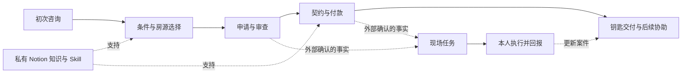
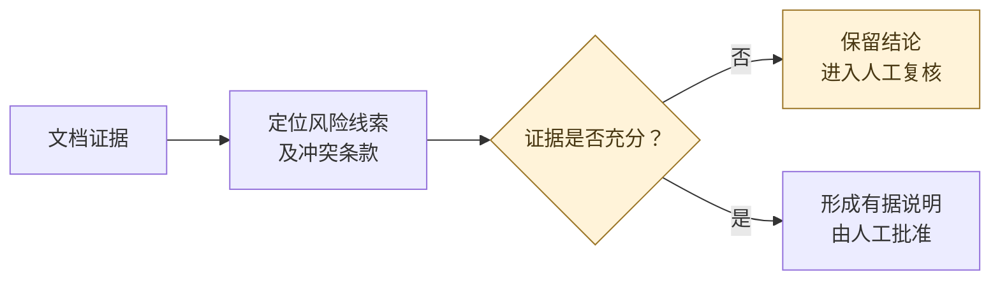

<a href="README.md">English</a> · <a href="README.ja.md">日本語</a> · 中文详解

# Rental Lifecycle Orchestrator

**租赁客户生命周期编排：把客户对接、业务知识、AI 辅助与现实行动连接起来。**

[契约中文说明：公开技术案例](docs/contract-explanation-case-study.md) · [研究方向与已核实论文](docs/research-directions.md)（正文为英文）

我从事日本租赁相关工作约**四年**，累计全程负责 **300+ 成交客户**，工作从初次咨询持续到钥匙交付及后续协助。年限和数量为本人提供的经验估算，描述的是我的业务经历，不代表 AI 系统处理了相同数量的客户。

长期接客积累的不只是聊天记录。更有用的是知道一条信息为什么重要、某个阶段还缺什么、哪些情况必须再问，以及什么时候该真正去做一件事。这个项目把这些判断整理成流程、知识结构、任务技能和程序模块，并记录它们如何配合。

## 想把日常工作变成什么样

客户发来需求后，系统逐步整理条件、准备资料、形成回复并协调进度。到了需要电话确认、现场签约或领取钥匙时，向本人交付一项有明确前提、时间和完成回报的任务。目标是减少盯着多个聊天反复追问和记忆下一步的精力，让常规沟通与状态整理更多地由系统承担。

例如，契约书到件是一个事件；签约安排还需要确认时间、地点与前置条件。最终有用的输出是一张可以执行、可以回报结果的任务卡。模型写出一句“可以签约了”，还不能自动成为案件事实。

这个方向以真实业务为起点，目前已有 Notion 流程与短语库、可调用的工作 Skill、文档交付实践，以及基于 [Jev](https://github.com/jev-chat/jev-chat-jarvis-mac) 的私有租赁扩展。本仓库公开项目思路、选定案例和技术判断，核心实现与业务知识保留私有。

## 业务问题怎样变成技术问题

租赁业务是一种持续时间长、信息只能局部获取的流程。同一个案件横跨客户聊天、房源资料、管理公司反馈、文件修订和现场交接。每次回复之前，担当者都可能需要重新判断：客户现在在哪个阶段，哪些信息已确认，什么只是暂定，以及下一步依赖谁的反馈。

设计时要处理三种差异。通用规则与个别客户事实的变化速度不同；当前屏幕能够提供的信息与整个案件的历史不同；写错一句候选回复，与安排一次尚未确认的现场行动，产生的影响也不同。这些差异决定了哪些工作交给检索，哪些交给规则，哪些适合模型辅助，以及哪些需要明确的业务确认。

因此，项目把**知识检索、案件状态解释、行动就绪判断**分开处理。知道客户处于签约准备阶段，可以帮助选择参考资料，却不能据此认定全部条件已齐。文件已经生成，也不代表已经核对并交付；一个任务已经提出，也不代表时间地点已经确认。这些区别需要体现在模块之间的交接中。

| 实务中的负担 | 对应的技术处理 |
|---|---|
| 相似说明反复出现，但每位客户条件略有不同 | 维护统一知识源，按当前问题检索 |
| 信息分散在多轮聊天、电话和文件里 | 设计带来源和待确认项的持久案件状态 |
| 模型回复流畅，却可能带出过度确定的结论 | 使用确定性校验，区分候选、事实与行动 |
| 担当者必须不断记住下一步该去哪里做什么 | 把确认事件转成有前提和完成回报的任务 |

## 已经形成的资产

| 资产 | 已有依据 | 在流程中的用途 |
|---|---|---|
| Notion 业务知识 | 业者向与客户向流程、快捷短语、归档及交接规则 | 维护阶段、交接点与重复说明 |
| 五类 Skill | 契约中文说明、费用概算、初期费用请求书、房源筛选、校区房源推荐 | 把阶段内的工作变成有输入、输出和检查方法的任务 |
| 客户文档实践 | 已存在合同中文说明和费用文件，包含修订版本 | 为项目提供实际交付基础 |
| Jev 私有扩展 | 源码、安装文件比对及领域测试 | 按需获取上下文、知识检索、候选回复约束 |
| 验证记录 | **2026-10-21 重跑的 27 项选定离线测试通过**，另有 5 项合成输入函数检查 | 为具体模块提供有范围的依据 |
| 生命周期与任务编排 | 本仓库中的场景设计 | 持续状态、业务事件与任务派发的后续方向 |

自动发送与完整生命周期自主运行是开发目标。[验证记录](docs/verification.md)明确区分本次离线核验、历史本地模型调用和现场交互的验收范围。

## 从对话到现实行动

*这是目标流程示意，不是已部署自主系统的运行记录。*

### 案例一：一条消息该进入哪个阶段

“4 月 1 日入住”看上去有日期，却没有年份。本机日期检查会把这项信息保留为待确认，而不会自动套用一个年份。当前问题仍在条件收集阶段，相关知识也应围绕找房条件，不提前带入签约、银行或入住补件。

这个案例展示的是客户事实、当前问题和流程知识之间的关系。知识库可以告诉系统通常该问什么，不能替客户补出尚未确认的事实。

### 案例二：一个确认事件如何变成任务

契约到件、预约确认、钥匙可以领取，分别是不同事件。只有满足相应前置条件，才形成签约或取钥匙任务；缺少明确时间时继续确认。

任务卡保留“做什么、什么时候、去哪里、前提是什么、完成后回报什么”。这里展示如何减少人工持续跟进，不展开契约条款、收费口径和全部办理清单。

*这是使用合成事件的编排设计。前置条件满足后才提出任务，现场执行结果由本人回报。*

### 案例三：经验怎样回到下一轮流程

重复出现的问题先回到 Notion，更新说明、注意事项和示例；适合固定复用的沟通再进入快捷短语，涉及任务逻辑时才同步 Skill。业务需要时，整理可公开的房源或生活清单，支持小红书等中国媒体的下一轮获客。

[三个案例的输入、边界和检查方式 →](docs/case-studies.md)

## 技术思路与个人贡献

这里的技术主线可以概括为：**面向业务的检索增强、确定性校验，以及事件驱动的生命周期编排**。前两项有现存模块，编排层是后续设计。

| 技术术语 | 在这个项目里具体做什么 | 当前状态 |
|---|---|---|
| **词项检索增强（Lexical RAG）** | 组合条件分流、中文等 CJK 字符 bigram 与词项重叠匹配，把带来源的参考放进生成上下文 | 私有扩展已实现，更准确的机制名是 retrieval-augmented prompting |
| **上下文隔离与依据约束（Context Isolation / Grounding）** | 把流程参考与客户观测分开，防止模板内容被当成当前案件事实 | 已有提示层约束，不等于完整的安全隔离 |
| **确定性校验与启发式护栏（Deterministic Validation / Heuristic Guardrails）** | 用日历校验与部分措辞模式检查处理模型不应自行猜测的问题 | 已实现，有选定离线测试 |
| **限时桌面上下文获取（Bounded Context Acquisition）** | 原生快捷键触发有限采集请求，输出时考虑前台应用和会话变化 | 基于 Jev 的现有适配 |
| **带守卫条件的状态机（Guarded State Machine）** | 用确认事件和前置条件决定案件能否从当前阶段推进 | 生命周期编排的设计方向 |
| **幂等任务派发与旧任务失效（Idempotent Dispatch / Stale-task Invalidation）** | 同一通知重复到达只产生一次任务；改期后旧时间不能继续执行 | 后续验收要求 |

### 把一般规则和当前事实分开

流程模板中可能写着“已经付款”“审查通过”“已经拿到钥匙”。检索命中这些文字，只说明找到了相关参考，不说明眼前的客户已经完成相应步骤。私有扩展会在上下文中区分业务参考与可见对话，并对部分明显无依据的承诺进行检查。该检查覆盖有限，不能证明所有输出事实正确。

### 用可控的入口获取桌面上下文

本机 Jev 按需模式使用快捷键打开有限采集窗口，完成分析排程后停止读取。按需模式的输出由本人复制、确认目标聊天后粘贴和发送。会话可能在停止采集后切换，因此输出控制和前台状态都需要单独考虑。

Jev 提供桌面助手基础，包含截图与 OCR 等上游能力。我的工作是将它适配到租赁业务，并处理知识检索、日期、候选约束及相关状态问题。截图、模型和平台的原有能力不计为全部自研。

### 检索先解决当前问题

当前实现组合了条件分流与词项匹配，使用带来源的本地知识快照。选择它是因为现有知识有明确业务阶段，检索过程容易解释，也方便检查何时取错资料。没有将其包装成向量数据库、模型训练或已运行的多智能体平台。

### 从单次辅助走向持续编排

后续需要把客户消息、管理公司确认、电话结果和现场回报放到持久的案件上下文中。当前屏幕无法覆盖未打开的历史、另一台设备和线下沟通。持续状态、事件来源、执行前提和结果确认，是自动回复与任务派发要继续解决的部分。

[架构与数据边界](docs/architecture.md) · [工具选择与未来代理研究](docs/tooling-decisions.md)

## 系统模型与模块职责

架构分为**知识层、当前辅助链路、目标协调层**。Notion 与 Skill 定义如何处理工作；桌面链路获取有限上下文、检索资料并准备受约束的候选；目标协调层持续维护案件，依据确认事件安排回复或现场行动。

概念上需要区分案件、观测信息、确认事实、业务参考、行动提议和行动结果。这些对象描述设计中的职责，不表示已经有生产数据库按此运行。观测信息需要解释，行动提议需要依据，任务完成需要结果回报。把它们全部混进一段聊天摘要，会很难追查系统为什么推进了某一步。

这种分层也让未来工具的替换更清楚。新的桌面代理可以负责获取上下文，不必重新拥有全部业务规则；更换生成模型，不应该改变付款等事实如何确认；调整检索方式，可以使用相同的场景集合比较结果，而不必重写整个案件流程。

公开版本讲到职责、输入输出关系和检查方法。实际收费规则、客户记录、完整提示模板及内部操作口径仍保留私有。

## 可靠性怎样评估

不同层需要不同证据。日期函数可以直接检查输入输出；前台状态处理可以用离线测试夹具验证；生成回复要检查事实依据和当前阶段是否相关；现场任务还要检查前提、时间、地点是否仍然有效。某个函数通过测试，并不能直接证明下一层的业务结果正确。

现有依据包括安装源码一致性、27 项选定离线测试，以及 5 项已记录的合成输入函数检查。后续可以使用带阶段标签的合成场景、缺失或冲突事实、重复通知和改期事件，评估错误推进、无依据断言和重复派发等问题。目前没有给这些后续指标填入未经测量的成绩。

自动化程度的提升，意味着系统逐步承担更多协调职责。目标是让常规事项少占用日常精力，让人处理异常和现场任务；每扩大一类行动，都需要检查确认不足、信息过时和执行失败时能否正确恢复。[完整验证记录](docs/verification.md)

## 工具在这里各做什么

| 工具或方法 | 作用 | 当前定位 |
|---|---|---|
| Notion | 维护流程、短语和业务说明 | 已有私有知识源 |
| Codex 与 Skill | 按任务组织文档、费用及房源工作 | 已有工作方法与技能资产 |
| Jev 私有扩展 | 桌面上下文入口与租赁适配 | 已有本机模块，现场链路按范围验证 |
| Ollama | 提供本地模型调用路径 | 已有本地调用记录 |
| Raycast | 比较手动上下文获取与短语入口 | 调研候选，未作为本项目集成 |
| Muse、GPTdot、Grokbot、Growth | 研究未来个人代理、桌面代理或 AI 助手的可能角色 | 产品身份与适配待确认，不声称已接入 |

Muse 的等待名单来自本人当前的采用条件。对其他候选也先确认具体产品，再比较上下文覆盖、跨会话状态、工具接入、动作确认、可追踪性、数据路径、可用性与成本。一个软件能看当前屏幕，还不足以证明它能管理完整客户生命周期。

## 契约审查案例与学术收尾

[`chongshuo-contract-cn` 公开技术案例](docs/contract-explanation-case-study.md)围绕原状回復、通常損耗、广泛责任特约、跨文件金额冲突、证据追溯和人工审核展开。材料、金额与条款均为虚构；介绍的是既有私有 Skill 的作用与公开审查模型，不公开 Skill 原文、实际费用规则或客户材料，也不把风险提示写成自动法律裁决。

*契约审查的概念流程，不代表自动服务或已取得的评估结果。*

[Research Directions](docs/research-directions.md)核实并引用 **A Benchmark for Lease Contract Review、CUAD、LegalBench**，提出风险条款识别、有证据支撑的法律 AI、按错误代价安排人工审核、信息不足时保留判断（abstention）及可复现评估。另设 **Blockchain / Cryptographic Audit / Digital Signatures / Privacy-Preserving Verification** 架构比较，分析普通签名审计日志与许可链的权衡。相关机制均未实现，客户隐私信息不上链；本次收尾不增加业务执行功能。

## 赛季节奏

**1—4 月是大赛季。** 业务过程中简要记下卡点，结束后微调 Notion 流程与高频短语。需要继续获客时，再整理适合公开的清单，用于小红书等中国媒体。

**9 月是小赛季。** 业务量较小，主要面向海外审查留学生，围绕实际发生的来日安排和办理衔接做小范围修正。

固定维护路径是：记录卡点 → 更新 Notion → 把适用的固定沟通整理为快捷短语 → 必要时同步 Skill 或快照 → 检查相关场景 → 留下版本摘要。其他月份按需要维护，不增加复杂的日常记录负担。

[维护方法](docs/seasonal-maintenance.md) · [版本记录](CHANGELOG.md)

## 公开范围

这里公开知识组织方式、模块关系、技术取舍和合成案例。完整 SOP、语料、Skill、客户资料、合同账单与私有扩展保留在公开仓库之外。公开案例可供了解项目，核心商业资料不随仓库分发。

更多资料：[验证记录](docs/verification.md) · [来源与权利说明](docs/provenance-and-rights.md)
