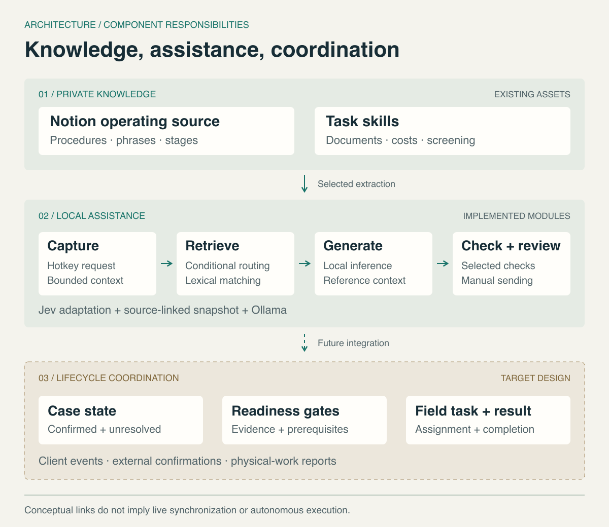
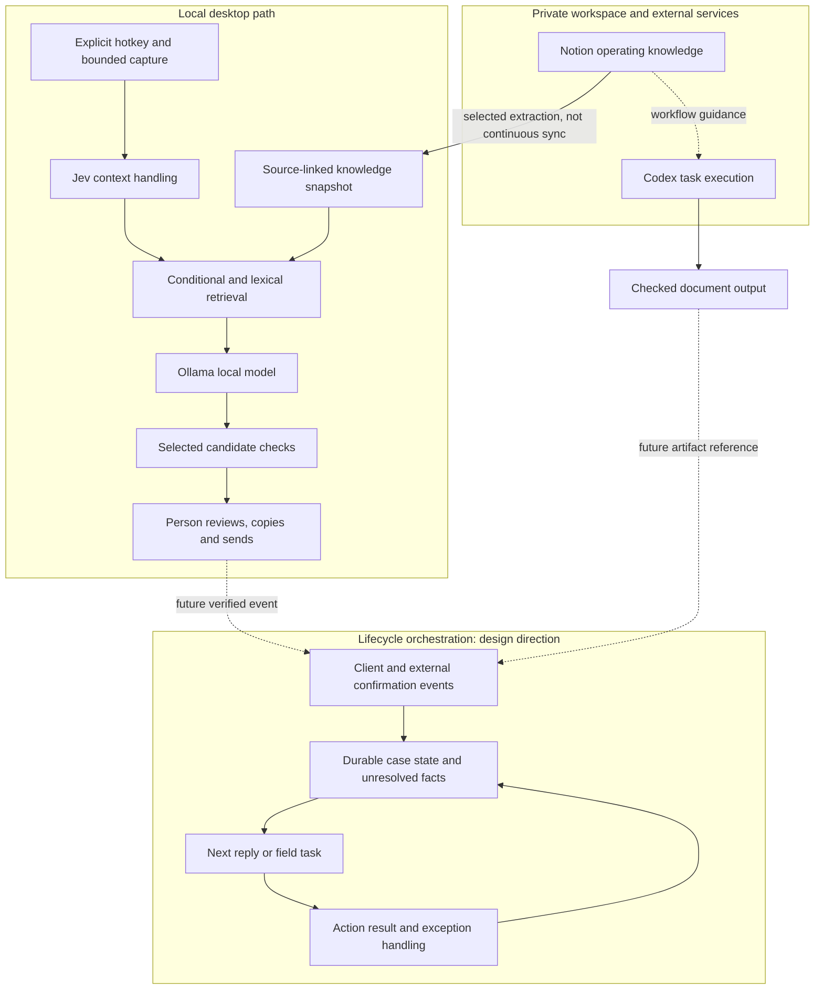

# Architecture: context, facts and actions

[Project](../README.md) · [Cases](case-studies.md) · [Verification](verification.md)

The architecture has two time horizons. The current implementation assists a person during particular tasks and conversations. The lifecycle direction adds durable case state and coordinates work across time, channels and physical actions.

## Current components and the target layer

Solid paths describe component relationships. Dashed connections into the target layer are proposed integrations. Notion-to-Codex workflow guidance is not a claim that an autonomous agent invokes the existing skills on every client event.

## Keep three kinds of information distinct

| Information | Example | Permitted interpretation |
|---|---|---|
| Reference knowledge | A workflow describes what happens after payment | Guidance about a possible situation |
| Case evidence | A relevant payment confirmation has been checked | A fact about that particular case |
| Proposed action | A draft suggests arranging key collection | A proposal that still depends on prerequisites |

Reference text is useful without being evidence. The existing extension labels retrieved business material separately from visible conversation context. The planned state layer must preserve that distinction over time, including which source supplied a fact and whether it remains unresolved.

## Mechanisms behind the terminology

### Retrieval-augmented prompting with lexical retrieval

The implemented path is `query + visible context → topic conditions → lexical fallback → source-linked references → augmented prompt`. The fallback uses CJK character bigrams and alphanumeric tokens, scores overlap with additional title relevance and a length normalization, and selects a narrow result. Topic-conditioned paths can return a selected set of references or no reference.

This is **lexical retrieval-augmented prompting**, sometimes described as lexical RAG. It grounds generation in retrieved reference text without training the model. Stage-related conditions are explicitly encoded; they are not evidence of a learned lifecycle classifier. No BM25, embeddings, vector database or semantic reranker is claimed for this private retrieval module.

### Prompt-level context isolation and deterministic validation

The extension separates reference material from current conversation text in the augmented context and supplies system-level instructions on how to use it. **Grounding** here means constraining the answer to relevant sources and confirmed client information. This is prompt-level handling, not a proven defense against every prompt-injection or hallucination case.

Calendar checks are **deterministic validators**: missing years, competing dates and invalid dates return explicit clarification states. Selected candidate checks are **heuristic output guardrails**: they match some unsupported commitments and suppress rejected candidates before display. The two mechanisms have different guarantees; passing a text-pattern filter does not establish factual accuracy. The [synthetic records](../evidence/deterministic-checks.json) show executed examples of both.

### Native event entry and bounded acquisition

The hotkey uses Python `ctypes` to call macOS Carbon's `RegisterEventHotKey`. A native hotkey event opens the request window; the assistant's existing acquisition loop then operates within that bound. **Event-triggered entry** therefore describes the hotkey, not a subscription to every client message.

The upstream capture route uses Apple Vision OCR; accessibility text is another upstream route. Foreground-state handling and copy-only output in the rental mode address a **stale-context** problem: the active conversation may change after the captured context was produced. This reduces one known destination risk; it does not prove every context-switch race is resolved.

### Event-driven orchestration and a guarded state machine

The target lifecycle layer is modeled as a **guarded finite-state workflow**. A case has a stage, unresolved facts and prerequisites. A verified event can enable a transition or task; generated prose alone cannot do so. The durable state must survive a screen change or restart, unlike a transient prompt.

**Idempotency** means a repeated notice should have one intended task effect. **Stale-task invalidation** means a changed appointment makes the old assignment non-actionable. **Provenance-aware transitions** retain the evidence behind a state change. These are design requirements and acceptance scenarios; no event bus, event-sourced database, transactional outbox or persistent workflow engine is claimed as implemented.

The current output path is **human-in-the-loop**. The longer-term ambition is routine autonomous coordination with **human-on-exception** handling, while physical actions and their completion reports remain explicit. Moving between those modes requires evaluating actual scenarios and action boundaries; a new agent product alone does not supply the missing state layer.

## Conceptual objects and module contracts

The following contracts describe the intended responsibilities between modules. They are a behavioral model, not a published API or an assertion that all objects have persistent implementations today.

| Concept | What it represents | Required distinction |
|---|---|---|
| Case | A particular client engagement over time | Its identity must outlast one visible chat window |
| Observation | Text, a document or a reported event | Acquisition is not the same as confirmation |
| Confirmed fact | Case information accepted with supporting evidence | Its source and current validity matter |
| Reference | A procedure, phrase or task instruction | It describes how work is normally handled |
| Candidate | A generated answer or proposed action | It does not change case state by existing |
| Task | A concrete assignment with prerequisites | Readiness differs from completion |
| Result | A report of what actually happened | Failure and exception remain valid outcomes |

The desktop adapter supplies observations; retrieval supplies references; the model supplies candidates; deterministic checks constrain selected interpretations. The target coordinator is responsible for confirmed state and action readiness. The person remains the source of physical-task results. Keeping these roles explicit makes a tool replaceable without silently transferring business authority to it.

The next orchestration layer should preserve traceability from an action back to its triggering event and relevant facts. That calls for durable case records, but it does not require the public dossier to choose a particular database, event bus or agent framework before implementation evidence justifies one.

## The implemented desktop adaptation

The private adaptation builds on Jev's desktop assistant. In the on-demand mode:

- A registered **Control+Shift+J** hotkey requests analysis. It is a hotkey registration, not a general keystroke logger.
- A capture request has an approximately **eight-second maximum window**. Analysis being scheduled closes the request; a permission prompt cancels that trigger.
- Rental retrieval uses conditional routing for selected topics and lexical matching for other inputs over a source-linked local snapshot.
- Date checks require enough information to interpret a move-in date. Multiple dates and invalid dates produce clarification rather than an invented resolution.
- The generation path uses a configured local model via a restricted loopback endpoint. Pattern checks reject some unsupported promises before displaying a candidate.
- In this mode, both copy and fill controls leave text on the clipboard. The person confirms the destination and sends the message.
- Foreground handling distinguishes focus on the assistant's own panel from leaving the relevant chat application. These behaviors have selected offline coverage.

The installed-source comparison and tests are described in the [verification record](verification.md). Upstream capture/UI mechanisms and the rental adaptation are distinct contributions.

## Why a screen is not a case record

A window can show only part of one conversation. It cannot establish what happened during a call, on another device, in an unopened thread or at a physical appointment. OCR can misread content; application layout and permissions can prevent capture.

Lifecycle coordination therefore needs durable records of confirmed events and unresolved questions. The next layer must be able to distinguish an old message from a new confirmation, a tentative date from an agreed appointment, and a proposed task from a completed action. Those requirements are design work in this dossier; a persistent state engine is not being distributed here.

## Task skills within the process

| Capability | Typical place in the process | Completion evidence |
|---|---|---|
| Listing screening | Requirements and property selection | Property-specific confirmed or unresolved conditions |
| Campus-oriented search | Initial search and comparison | A selection aligned with location and client requirements |
| Move-in cost estimation | Consultation and comparison | Assumptions, known items and explicitly unresolved costs |
| Initial-cost request document | Contract and payment preparation | Checked source items and arithmetic before delivery |
| Chinese contract explanation | Contract preparation | Source-grounded explanations and a separate internal check list |

These skills are maintained instructions and reference rules used in a tool-assisted workflow. Their existence does not mean a self-contained service automatically executes them. This public view omits their detailed rules and inputs containing customer information.

## Data and action boundaries

The local rental generation mode restricts its generation endpoint to a loopback service. Notion and Codex have separate service boundaries; the overall workflow is not claimed to run wholly offline. A connection to Notion also does not inherently imply a read-only or single-page permission boundary; access must be considered at the client and account level. See the [Notion MCP documentation](https://developers.notion.com/guides/mcp/get-started-with-mcp).

Automatic sending, state transitions and task dispatch require additional work on event identity, duplicate handling, provenance, cancellation and action confirmation. For example, a repeated key-release notice should not create two collection tasks, and an appointment changed after assignment should invalidate the earlier time. These are target acceptance scenarios, not capabilities inferred from the present desktop tests.
