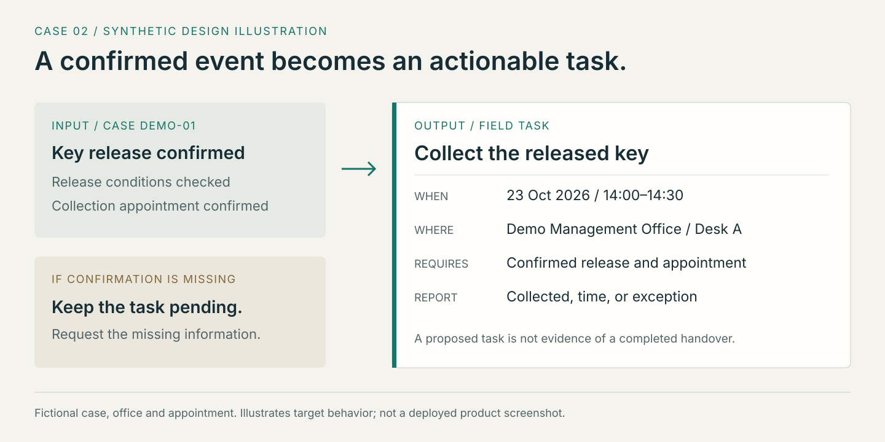

# Case studies: conversation, action, improvement

[Project](../README.md) · [Architecture](architecture.md) · [Verification](verification.md)

All client situations below are synthetic. The first case contains an executed deterministic function check. Field dispatch and seasonal examples are design illustrations, not evidence of a deployed autonomous system or a completed seasonal review.

## 1. Find the next question before drafting an answer

**Situation.** A prospective client writes: `4月1日入住` — “Move in on April 1.” The day and month are present, but the year is not.

**Observed check.** On 2026-10-21, the private extension's existing date function returned:

> 入住年份未明确，先确认年份，不自动推算。

English reading: the move-in year is unspecified; ask for it instead of assuming one. This is the original function result from a synthetic input, not an LLM-generated reply or a screen-capture result. The [machine-readable record](../evidence/deterministic-checks.json) also contains conflicting-date and invalid-date cases.

**Workflow implication.** The current question belongs to requirements gathering. Relevant knowledge should help clarify the date and housing preferences. It should not suddenly introduce later-stage payment or bank paperwork. Tests of the private retrieval path cover stage-related selection and the exclusion of unrelated material.

**Next orchestration step.** Store the year as unresolved, prepare a clarification and update it only when the client confirms. Persistent case updates and automatic sending are target behavior; this example does not claim either occurred.

| Scenario | Expected handling | Evidence type |
|---|---|---|
| Month and day, no year | Request the year | Executed deterministic check |
| Two competing dates | Ask which date is current | Executed deterministic check |
| Invalid calendar date | Ask for a valid date | Executed deterministic check |
| A retrieved phrase says “approved” | Keep approval unresolved unless case evidence confirms it | Design principle, reflected in private context instructions |

## 2. Convert a confirmed event into a field task

**Situation.** A management company confirms that the contract documents are available. The person should not have to reconstruct the whole conversation just to know whether a visit can be arranged.

**Design.** First identify what the event proves. Document availability alone does not prove that an appointment time has been agreed. Once the relevant prerequisites and appointment are confirmed, create a signing task. Key collection is a separate task, based on its own confirmed release conditions.

The minimum public task shape is:

| Field | Synthetic example |
|---|---|
| Task | Collect the released key for Case DEMO-01 |
| Time or window | 2026-10-23, 14:00–14:30, confirmed |
| Place | Demo Management Office, Desk A — fictional |
| Prerequisites | Relevant release conditions and appointment confirmed |
| Completion report | Record collected / not collected, time and any exception |

**Unresolved branch.** If the release notice is missing, keep collection pending. If the time is unknown, ask for it. If an appointment changes, the earlier task time must cease to be actionable. The person performs the physical action and reports the result; writing a task is not proof of completing it.

This case intentionally stays at the coordination level. Actual signing requirements, charges and internal handling instructions remain private. Existing document skills can support the preparation stage without becoming public operating manuals.

**Acceptance scenarios for the future layer:** confirmed event creates one appropriate task; missing prerequisites hold it; a repeated event does not duplicate it; a changed appointment invalidates the old time; failed collection records an exception rather than marking handover complete.

## 3. Turn seasonal friction into the next revision

**Situation.** Similar questions recur during the main season. The underlying issue might be a confusing explanation, a missing handoff or information that changed.

**Design illustration.** Suppose clients repeatedly misunderstand whether a proposed appointment is confirmed. Record the issue category privately, verify the correct stage and revise the Notion explanation and example. If the communication is stable and frequent, maintain a phrase for that trigger and expected result. Update a skill or local snapshot only if its behavior depends on the changed rule.

Use the original confusing situation again to check the revision. Publish a short statement such as “clarified proposed versus confirmed appointment handling,” while retaining the exact phrasing and business rules privately. This is an example of what a future update entry could describe; it is not a claim that this particular revision already took place.

The main cycle is January–April, followed by a small review. September is smaller and mainly concerns students applying from overseas. When business needs call for it, selected public property or living-information checklists can support Chinese-media outreach. They do not expose the internal knowledge used to manage clients.

**Useful outcome.** The same operational source can improve dialogue, task preparation and the next season's communication. Its value comes from keeping these connected, rather than accumulating more undifferentiated notes.
