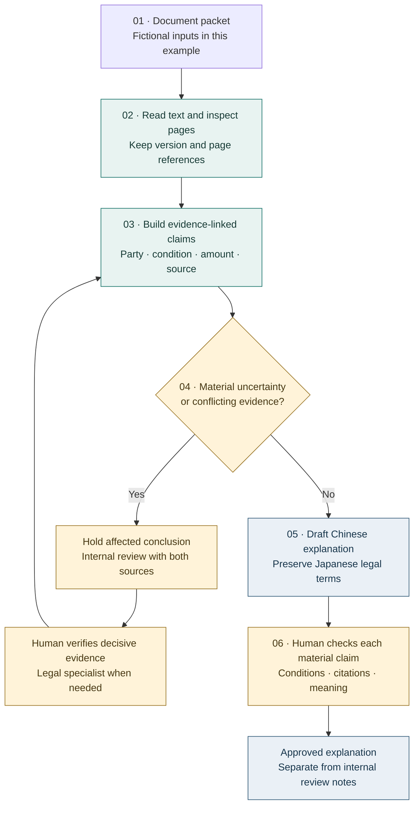

# Contract explanation as evidence-based review

[Project](../README.md) · [Research directions](research-directions.md) · [Verification](verification.md)

**Public technical case: `chongshuo-contract-cn`（契约中文说明 Skill）.** The maintained private skill supports a person preparing Chinese explanations of Japanese residential rental contracts. This page explains the engineering problem and a public review model. It does not distribute the skill, its prompts, private reference rules, fee policies or operational templates.

**Evidence boundary.** The skill is an existing instruction-and-reference asset, used in a tool-assisted document workflow. It is not a standalone legal classifier. The examples and decision records below are newly invented design illustrations, not execution traces. No contract-review accuracy, automatic risk detector or production evidence database is established by this page. The desktop tests in [verification](verification.md) do not evaluate this contract-review task.

## Why translation alone is insufficient

A fluent translation can preserve a sentence while losing its conditions. A clause may assign a cost only after a particular event, an annex may change its scope, or a separate estimate may use a conflicting amount. The useful technical unit is therefore a **claim with supporting evidence, conditions and an unresolved state**, rather than a paragraph of confident Chinese.

Four questions must remain separate:

| Question | Example | What would answer it? |
|---|---|---|
| What does the document say? | A special clause assigns replacement costs | The exact clause and applicable annex |
| What is the general legal background? | How ordinary wear is normally treated | Current authoritative guidance, with its scope |
| Is this particular clause enforceable? | Whether an unusual burden is valid | Legal analysis of the wording, agreement and circumstances |
| What can be released to the client? | A clear explanation of a verified obligation | Human approval after resolving material uncertainty |

A source citation answers the first question only if it actually supports the claim. It does not automatically answer the third.

## Original condition, ordinary wear and special clauses

**原状回復** should not be translated as an unconditional obligation to make the room new. The Ministry of Land, Infrastructure, Transport and Tourism (MLIT) describes a general allocation that distinguishes normal aging and ordinary use from damage attributable to matters such as negligence or use beyond the ordinary. It also discusses elapsed years and the scope of repair. These are general guidelines for the stated residential context, not a finding about any fictional clause below. [MLIT overview, points (1)–(4)](https://www.mlit.go.jp/jutakukentiku/house/jutakukentiku_house_tk3_000020.html)

**通常損耗** and **経年変化** must remain visible concepts in the explanation. The model must not silently merge them with tenant-caused damage. Conversely, a special clause cannot simply be erased because it departs from the general allocation. MLIT's Q&A discusses understanding and agreement, relevant mandatory rules, and conditions concerning unusual restoration burdens. “Unfavorable” does not by itself establish “invalid.” [MLIT Q&A, Q3 and Q5](https://www.mlit.go.jp/jutakukentiku/house/jutakukentiku_house_tk3_000024.html)

The review objective is to identify the wording, explain the possible consequence, and route uncertain legal interpretation to a qualified reviewer. It is not to tell a tenant automatically that payment is required or that an obligation may be ignored.

## A fictional packet with three connected problems

Everything in this packet is invented: document labels, clauses, page references and amounts. The numbers demonstrate disagreement only; they are not prices, recommended charges or a reconstruction of private business rules. No actual contract text is quoted.

| Fictional source | Invented content | Review consequence |
|---|---|---|
| DEMO-A, lease v1, PDF p. 4, §8 | The restoration section distinguishes ordinary use from tenant-caused damage | Retain this distinction when explaining the general section |
| DEMO-B, annex v1, PDF p. 2, §3 | “借主は、故意・過失の有無を問わず、退去時に壁紙全体の交換費用を負担する。” | Flag a potentially broad special burden; read it together with DEMO-A |
| DEMO-C, estimate v1, PDF p. 1, row 6 | A fictional exit-cleaning item is JPY 24,000 | Compare the item, trigger and tax basis with other sources |
| DEMO-B, annex v1, PDF p. 2, §4 | The apparently corresponding item is JPY 36,000 | Preserve both values; do not choose one or average them |
| DEMO-D, listing snapshot v1, PDF p. 1 | A fictional benefit says no key money; the estimate includes a key-money item | Check whether the same offer and contract version apply |

### Problem 1: broad restoration liability

The invented annex assigns **all wallpaper replacement** regardless of fault. A useful red flag identifies at least the party, scope, trigger, fault condition and potential consequence. It also retrieves the general restoration clause, instead of quoting the annex in isolation.

The reviewer should determine what was agreed, whether the annex applies to this contract, whether its meaning is clear, and whether specialist legal review is needed. The flag remains a reason to investigate. A keyword such as “全部” is neither a sufficient legal test nor proof that every matching clause is problematic.

### Problem 2: amounts disagree across documents

First test whether the amounts represent the same obligation: exit versus entry, included versus additional service, tax-inclusive versus tax-exclusive, optional versus mandatory, draft versus final. A difference can be explainable without either source being false.

If the relevant conditions really match and the difference remains unresolved, the safe result is **conflicting evidence**. Do not let generation choose the newest-looking file, the majority value or the smaller number. Record the conflicting locations and request decisive written clarification or an applicable corrected document through the authorized human workflow. The wording and authority of a correction matter; a date alone does not establish precedence.

### Problem 3: a marketed benefit conflicts with the estimate

“No key money” in a listing and a charge in an estimate create a cross-document consistency question, not an automatic conclusion of wrongdoing. Confirm the offer period, room, document version and applicable conditions. If the discrepancy affects a material client obligation, hold the affected final explanation for review. Public documentation contains no real calculation formula or collection arrangement.

## Review flow and publication gate

*Conceptual review model, not an executable pipeline. The diagram describes a public abstraction of tool-assisted work; it does not certify an automated implementation.*

Unclear OCR on a number or exception is a reason to inspect the page. “Not found” must distinguish a missing clause from an unreadable or incomplete packet. Embedded text that tells an assistant to ignore other evidence is document content, not authority to change the review policy.

## What evidence traceability should preserve

The following is a **proposed review record**, not a published schema from the private skill or an implemented API:

| Field group | Fictional illustration | Purpose |
|---|---|---|
| Claim identity | REVIEW-DEMO-01, restoration scope | Connect revisions without relying on prose similarity |
| Source identity | DEMO-B v1, PDF p. 2, §3 | Make the original wording recoverable |
| Supporting context | DEMO-A v1, PDF p. 4, §8 | Retain exceptions and related clauses |
| Observation | All wallpaper, regardless of fault | Separate what is written from interpretation |
| Review reason | Potentially broader burden than the general section | Explain why human attention is needed |
| Evidence state | Located / conflicting / unreadable / absent from supplied packet | Prevent a missing source from becoming a negative fact |
| Disposition | Hold interpretation; specialist review if unresolved | Keep the proposed response distinct from a decision |
| Revision lineage | Reviewer decision and supporting correction | Explain what changed and why |

In a future implementation, page numbering should specify PDF index versus printed page; spans should retain enough context to check negation and exceptions. A document digest can help identify a version, but it does not prove authenticity, truth or permission to process it. These records belong in access-controlled storage, not a public repository.

## Human review and abstention

**Abstention** means withholding a particular unsupported conclusion while identifying the missing evidence for the reviewer. It does not mean inventing a likely answer or refusing every task. It can be local: verified terms may still be prepared while a disputed restoration amount remains on hold. A materially incomplete explanation must not be presented as a complete, approved account.

An internal review note for the invented annex could say:

> DEMO-B p. 2 §3 appears to assign all wallpaper replacement regardless of fault. Compare DEMO-A p. 4 §8 and verify the annex's applicability. No conclusion on enforceability has been approved.

A Chinese **working draft for reviewer inspection**, not an approved client output, could say:

> 附件中的壁纸更换条款将费用责任写得较广，包含“无论有无故意或过失”的表述。其适用范围及效力需要结合契约全文与具体合意审查，不能据此直接认定必须承担全部费用，也不能直接认定条款无效。

Reviewer effort should follow consequence and uncertainty: missed financial burdens, conflicting amounts, unclear exceptions and legal interpretation deserve priority. Low-risk formatting corrections need a different level of attention. A future queue must also sample apparently unproblematic cases, because an undetected red flag will never enter a queue built only from detected flags. No cost-sensitive review scheduler is claimed as implemented.

## Public safety and the technical stopping point

This case publishes a problem formulation, fictional packet and review rationale. It omits private Skill wording, operational thresholds, actual fees, client identities, contact details, company payment data and sensitive source locations. Citations point to public guidance. No client document or screenshot is included.

The current stopping point is a documented, human-reviewed method with explicit limits. A future research project could implement an independently specified detector and evaluate its evidence quality, missed risks and abstention behavior. That work needs a lawful dataset, annotations and a reproducible protocol; this case itself supplies no benchmark result. Continue with [Research directions](research-directions.md).
