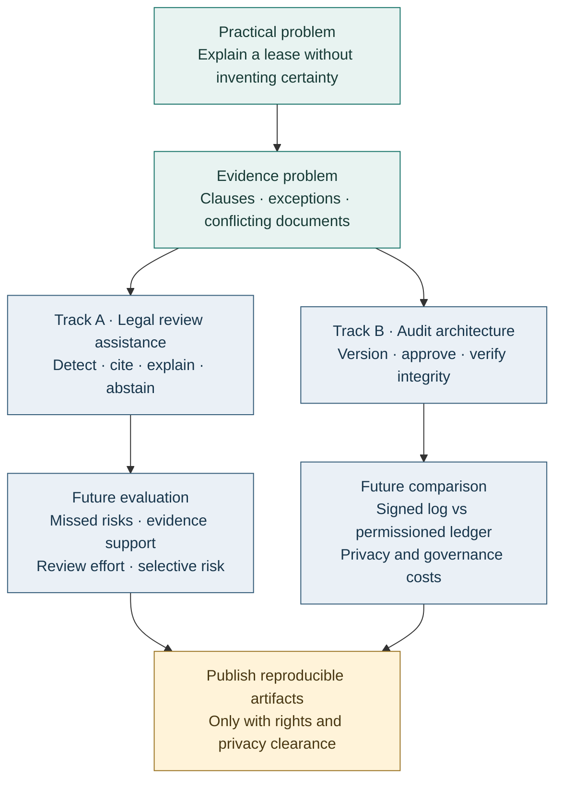
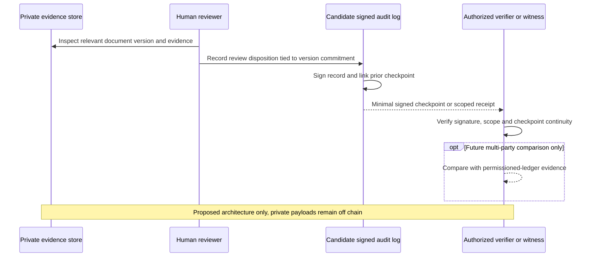

# Research directions

[Project](../README.md) · [Contract explanation case](contract-explanation-case-study.md) · [Architecture](architecture.md) · [Verification](verification.md)

**Status: research agenda and architecture comparison, not implemented capabilities or experimental findings.** This page closes the public technical account at a reviewable boundary and leaves concrete questions for future student or independent research. No new business execution features, legal model, benchmark run, cryptographic audit service, blockchain integration or digital signing service is introduced here.

## From a practical workflow to research questions

The [contract explanation case](contract-explanation-case-study.md) asks how a person can explain Japanese rental obligations in Chinese without concealing uncertainty. The research problem is broader than translation: locate a consequential clause, retain its conditions, reconcile documents, provide evidence and decide when a person must review the result.

Existing private task instructions and document practice motivate these questions. They do not constitute a labeled corpus or a measured legal-AI system. The [verification record](verification.md) concerns selected desktop-assistance behaviors; its 27 offline tests and five synthetic function checks are not contract-review benchmark results.

*Research map. Every downstream track is proposed; the arrows are conceptual dependencies.*

## Verified literature and limits of transfer

Bibliographic metadata and the descriptions below were checked against the linked primary sources on **2026-10-21 (Asia/Tokyo)**. These are methodological references, not claims of affiliation, reproduced results or adoption of their models. No paper figures or dataset documents are republished.

| Reference | What the source establishes | Relevance here | Transfer limit |
|---|---|---|---|
| Leivaditi, Rossi and Kanoulas (2020), **A Benchmark for Lease Contract Review** [R1] | A manually annotated benchmark of **179 lease documents**, addressing entities and red flags; introduces **ALeaseBERT** | Separate identifying terms from detecting potentially consequential clauses | SEC EDGAR source documents and task-specific risk categories do not establish Japanese residential legal validity |
| Hendrycks, Burns, Chen and Ball (2021), **CUAD: An Expert-Annotated NLP Dataset for Legal Contract Review** [R2] | **510 commercial contracts**, **41 categories**, over **13,000 annotations**; focuses on highlighting relevant contract spans | Evaluate whether the reviewer receives the relevant clause, rather than only plausible prose | Important-clause extraction is not an automatic finding of unlawfulness or an evaluation of Japanese-to-Chinese explanation |
| Guha et al. (2023), **LegalBench: A Collaboratively Built Benchmark for Measuring Legal Reasoning in Large Language Models** [R3] | **162 tasks** spanning **six types of legal reasoning**, developed with legal-professional involvement | Decompose legal tasks and use explicit task definitions and labels | A broad reasoning benchmark does not validate this workflow, its jurisdiction or its financial consequences |

The lease paper's selected collection and the SEC filing context of CUAD also caution against treating their document distributions as everyday residential practice. A Japanese residential task needs its own scope, law and guidance date, document structure, language review and error taxonomy. Translating benchmark text would not remove that domain shift.

## Track A: evidence-grounded legal AI

### Red-flag detection as review prioritization

A red flag means “review this issue and its conditions.” It is distinct from both a named entity and a judgment of enforceability. A restoration provision may mention a tenant and an amount without assigning an unusual burden; a consequential exception may contain no obvious risk keyword.

An initial task could label the **span, affected party, obligation, trigger, exception, reason for review and supporting context**. The fictional all-wallpaper replacement clause is one candidate scenario. Include ordinary clauses, narrow exceptions and difficult negatives so that a detector cannot succeed merely by flagging every reference to 原状回復.

**Question:** Does contextual detection improve recall of materially broad obligations without overwhelming reviewers? Compare a keyword baseline with a model given the clause alone and one given relevant surrounding sections. This is a proposed experiment; no approach is selected as empirically superior here.

### Evidence-grounded explanation

Treat locating a citation and supporting a claim as separate tasks. A real page can be cited while its exception is omitted or its party roles reversed. An explanation should distinguish what a contract says, what public guidance says and what remains a legal interpretation.

**Question:** Does requiring claim-to-span support reduce unsupported obligations in Chinese explanations? Evaluate citation validity, support of the complete claim, coverage of material claims, preservation of conditions and party roles, and consistency across revisions. Score retrieval failures separately from reasoning or translation failures. Public guidance should have a version or access date; retrieved text should be treated as evidence to inspect, not instructions to obey.

### Cost-sensitive human review

Missing a costly obligation and asking for an unnecessary review have different consequences. A future study could define:

`L = c_FN × FN + c_FP × FP + c_review × N_review`

Here FN counts missed material issues, FP counts unnecessary flags, and N_review counts reviewed cases or issues under a declared unit. The coefficients are **research assumptions**, not actual private fees or measured damages. Review time can be reported separately. Costs must use compatible units, avoid unintended double counting and be varied in sensitivity analysis.

**Question:** At the same reviewer budget, does prioritization reduce severe misses relative to reviewing in arrival order? Report per-category outcomes, issue prevalence, reviewer minutes and residual misses. Randomly sample unflagged cases for audit. A queue cannot be judged only by the flags it successfully raised, and financial impact alone must not hide non-financial rights or safety issues.

### Abstention and selective prediction

An assistant should be able to decline a particular conclusion when pages are unreadable, sources conflict, an annex is missing or the legal scope is unsupported. Abstention should identify what evidence would resolve the issue for the reviewer. An unreviewed “no problem found” must not be treated as approval.

**Question:** Can evidence-based routing reduce error at a useful level of coverage? Plot **risk versus coverage**, where coverage is the fraction receiving a substantive model answer and risk is the error rate among those answers under a declared rubric. Also report missed high-impact issues over **all eligible cases**, review workload, unnecessary abstentions and unresolved cases. Otherwise, declining difficult cases could create a misleadingly high score.

Confidence generated in prose is not a calibrated probability. Any learned score, evidence gate or threshold needs development-set selection and held-out evaluation. A final human-reviewed output and an unaided model output are different systems and should receive separate scores.

## A future reproducible evaluation protocol

This protocol is a proposal. **No dataset, labels, implemented harness, reviewer study or performance results are released by this documentation update.** A small pilot should establish feasibility before making broad claims.

| Step | What to fix before testing | What would make the work inspectable |
|---|---|---|
| Define the task | Japanese residential scope; source date; review unit; label meaning; intended use | Versioned task specification and exclusions |
| Construct lawful materials | Independently authored synthetic packets first; licensed or authorized documents only if available | Rights manifest, provenance and privacy review; no private client corpus by default |
| Design challenge cases | Ordinary wear, broad special clauses, negation, missing annexes, OCR errors, conflicting amounts and version changes | Paired fictional variants and explicit expected evidence |
| Annotate independently | Two reviewers, including relevant legal expertise; resolve disagreements without using model output as ground truth | Label guide, agreement report, adjudication rationale and unresolved labels |
| Split before tuning | Keep related contracts, templates, amendments and paraphrases in the same partition | Frozen train/development/test manifest; duplicate and leakage checks |
| Compare baselines | Keywords; model without retrieval; evidence retrieval plus generation; optional review routing | Same available documents and budgets; versioned prompts, settings, model IDs and seeds where supported |
| Score in layers | Span extraction, issue detection, conflicts, Chinese fidelity, citation support and abstention | Per-category counts, denominators, error examples and uncertainty intervals grouped by document family |
| Compare human workflows | Unaided review versus assistance; counterbalanced order, common rubric, reviewer time | Study protocol, reviewer qualifications, agreement and separate pre-/post-review outcomes |
| Package reproducibility | Only material whose publication is permitted | Synthetic fixtures, labels, runnable harness, dependency versions, configuration and aggregate results |

Issue detection can report precision, recall and F1; span extraction needs a declared exact-match or overlap rule. Cross-file conflict scoring should identify the **pair of sources and the disputed condition**, not just an “inconsistent” label. Hallucinated obligations should be counted explicitly. Repeated runs and document-family uncertainty estimates would help separate model variance from a small sample effect.

Human disagreement should remain visible rather than be rewritten as certainty. Public benchmark contamination is another limitation: when exposure to a released benchmark cannot be excluded, report it and evaluate independently authored held-out variants as a separate task. Synthetic performance would establish behavior on those constructions only, not real-world legal reliability.

## Track B: Blockchain / Cryptographic Audit / Digital Signatures / Privacy-Preserving Verification

**All mechanisms in this section are future architecture candidates and remain unimplemented.** The immediate research question is how to verify which version was reviewed and approved while minimizing disclosure. A blockchain is one possible coordination mechanism, not a prerequisite for evidence-grounded review.

### Define the threat before choosing the ledger

Potential failures include changing a document after approval, rewriting a review history, presenting different histories to different parties, using a compromised signing key, or asserting that an incorrect original record was true. Integrity mechanisms address different subsets of these failures.

A digest can identify bytes; a digital signature can bind a message to a key under its trust assumptions [R5]. Neither proves that the document is truthful, that a person had legal authority, that they understood a clause, or that payment or key handover actually occurred. A local timestamp alone is not independent time evidence. Cryptographic signing of audit records is also distinct from legally effective electronic contract signing, which would need its own identity, consent, authority and legal analysis.

### Compare the smallest credible alternatives

| Candidate architecture | What it could help establish | Trust and operational cost | Limits and fit |
|---|---|---|---|
| Access-controlled database with version history | Who recorded a revision under application permissions | Trust one operator, backups and access controls | Simple baseline; a sufficiently privileged operator may rewrite history |
| **Conventional signed audit log** with linked records and independently retained checkpoints | Authenticity of signed records and detectable changes relative to retained checkpoints | Key custody, canonical serialization, rotation, revocation, retention and external witnesses/checkpoints | Preferred baseline to investigate for one operator; a hash chain retained only by its writer can be rewritten or truncated |
| **Permissioned blockchain** among independent organizations | Shared ordering and replicated history under an agreed consensus/governance model [R4] | Participant identity, node operation, consensus assumptions, onboarding, disputes and recovery | Worth studying only when independent writers require shared control; participants may still collude or submit false facts |
| Public-chain anchoring of a commitment | An external record that a commitment was included, under chain assumptions | Public permanence, fees, metadata exposure and chain operation | Optional comparison only; no client data, encrypted contract payload or identity-linked event should be placed on chain |
| **Privacy-preserving verification** through selective disclosure or zero-knowledge proofs | A precisely defined statement about committed data, revealing less than the full record | Commitment design, proof-system assumptions, implementation review and proof cost | Separate research topic; proof of a narrow predicate does not validate the legal reasoning or its source facts |

A single operator does not gain independent governance merely by running several nodes. Conversely, a signed log can be useful without distributed consensus. RFC 9162 offers an example of Merkle inclusion and consistency proofs in the **different domain of certificate transparency** [R6]; it is a technical reference, not a ready-made contract-audit protocol or a recommendation to publish private records.

### Proposed minimal disclosure path

The record would need canonical bytes, document-version identity, review scope and version, decision type, key identifier and prior-record linkage. Key ownership, compromised-key handling and independent checkpoint retention require explicit design. A later correction should supersede a decision while retaining a controlled audit trail; it cannot silently make the original assertion correct.

### Keep customer information off chain

Do not put client names, addresses, contact details, contract text, invoices, payment information, signatures, private prompts, fee rules or sensitive paths on a public or permissioned chain. Encryption does not remove the long-term disclosure and deletion problems of replicating private payloads. Even event timing, stable identifiers and access patterns can reveal relationships.

A bare hash of a predictable amount or identifier can be guessed and linked. Candidate commitments would need suitable hiding properties, such as a carefully designed randomized commitment; a public salt alone does not stop guesses of a low-entropy value. Keep openings, linkage tables and private payloads in separately authorized storage, disclose only what the verification purpose requires, and assess whether even an aggregate commitment creates unacceptable leakage. No digest or proof is claimed to anonymize data by itself.

For example, a future proof might establish that a particular approved version belongs to a committed review set without revealing the contract. It would not prove that the review was legally correct or that no relevant annex was omitted. Identity binding, completeness of the submitted material and the truth of outside events remain separate problems.

### Research questions for an architecture comparison

Use identical **synthetic** document changes and review events for each candidate. Test mutation after approval, missing or reordered records, truncation, equivocation, key compromise, revocation, document corrections, node failure and unauthorized correlation. Measure detection coverage, independently verifiable evidence, latency, storage, operating effort and privacy leakage under stated assumptions. No measurements are available here.

Study a permissioned ledger only after identifying genuinely independent participants and a reason one operator's signed checkpoints are insufficient. Study zero-knowledge proofs only after defining the exact private input, public statement and verifier need. The smallest defensible result may be that a conventional signed log is sufficient for the chosen threat model; that remains a hypothesis to test, not an implemented design decision.

## A bounded academic handoff

The completed public contribution is the problem framing, practical case, implementation/evidence boundary and proposed study design. The next empirical contribution would require an independently specified task, lawful materials, reviewed labels and a reproducible comparison. Until those exist, this project makes no claim of legal-AI accuracy, labor savings, cryptographic assurance or blockchain deployment.

## References

- **[R1]** Spyretta Leivaditi, Julien Rossi and Evangelos Kanoulas. 2020. *A Benchmark for Lease Contract Review*. [arXiv:2010.10386v1](https://arxiv.org/abs/2010.10386v1). Scope checked against the abstract and §§3–5, including document selection from SEC EDGAR.
- **[R2]** Dan Hendrycks, Collin Burns, Anya Chen and Spencer Ball. 2021. *CUAD: An Expert-Annotated NLP Dataset for Legal Contract Review*. NeurIPS Datasets and Benchmarks. [arXiv:2103.06268v2](https://arxiv.org/abs/2103.06268v2) · [Author repository](https://github.com/The-Atticus-Project/cuad). Counts and extraction scope checked against the paper's dataset description.
- **[R3]** Neel Guha et al. 2023. *LegalBench: A Collaboratively Built Benchmark for Measuring Legal Reasoning in Large Language Models*. [arXiv:2308.11462v1](https://arxiv.org/abs/2308.11462v1) · [NeurIPS publication](https://papers.neurips.cc/paper_files/paper/2023/hash/89e44582fd28ddfea1ea4dcb0ebbf4b0-Abstract-Datasets_and_Benchmarks.html) · [Author repository](https://github.com/HazyResearch/legalbench). Task count and reasoning scope checked against the abstract and project documentation.
- **[R4]** Dylan Yaga, Peter Mell, Nik Roby and Karen Scarfone. 2018. *Blockchain Technology Overview*. [NIST IR 8202](https://csrc.nist.gov/pubs/ir/8202/final). General reference on distributed ledgers and consensus; the rental architecture comparison is proposed here.
- **[R5]** NIST. 2023. *Digital Signature Standard (DSS)*. [FIPS 186-5](https://csrc.nist.gov/pubs/fips/186-5/final). Reference for digital-signature properties; not a claim of implementation or compliance. Consult the publisher's errata before any future implementation.
- **[R6]** Ben Laurie, Eran Messeri and Rob Stradling. 2021. *Certificate Transparency Version 2.0*. [RFC 9162, §2](https://www.rfc-editor.org/rfc/rfc9162.html#section-2). Experimental protocol; cited for cryptographic log components in its own application domain.

For the Japanese restoration background, see the case study's links to the [MLIT guideline overview](https://www.mlit.go.jp/jutakukentiku/house/jutakukentiku_house_tk3_000020.html) and [Q&A](https://www.mlit.go.jp/jutakukentiku/house/jutakukentiku_house_tk3_000024.html). These public references do not replace current, case-specific legal review.

[R1]: https://arxiv.org/abs/2010.10386v1
[R2]: https://arxiv.org/abs/2103.06268v2
[R3]: https://arxiv.org/abs/2308.11462v1
[R4]: https://csrc.nist.gov/pubs/ir/8202/final
[R5]: https://csrc.nist.gov/pubs/fips/186-5/final
[R6]: https://www.rfc-editor.org/rfc/rfc9162.html#section-2
