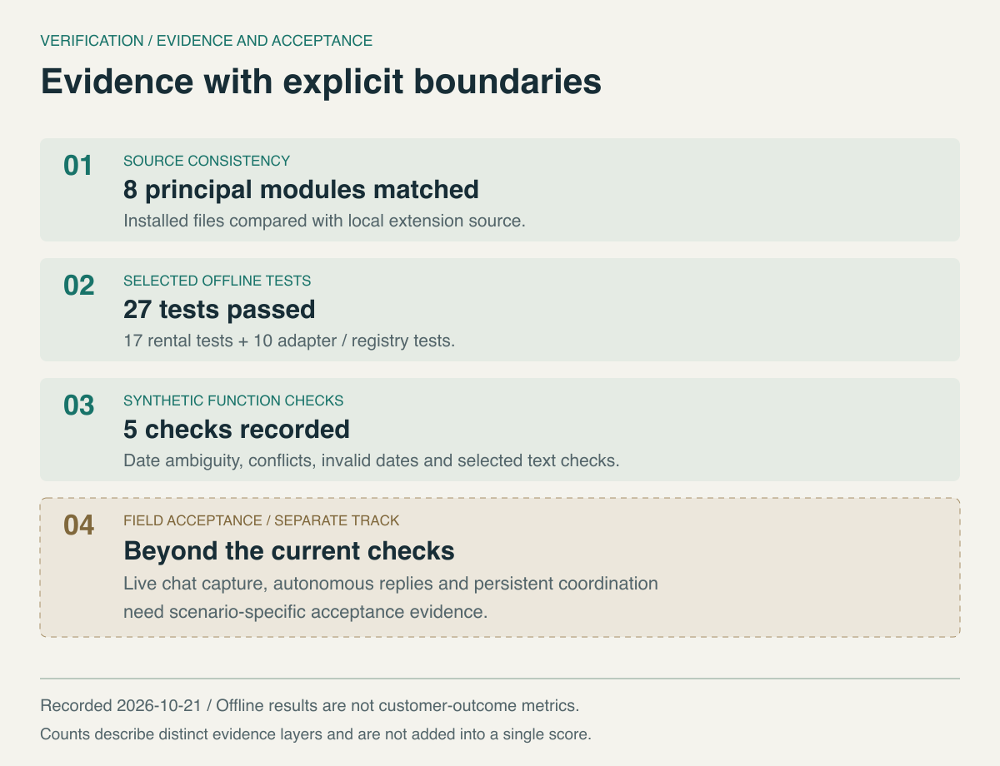

# Verification record

[Project](../README.md) · [Synthetic function results](../evidence/deterministic-checks.json)

Recorded on **2026-10-21, Asia/Tokyo**. This record distinguishes inspected assets, executed checks, historical reports and design cases.

## Current inspection

- Five relevant rental task skills and their supporting reference files exist locally.
- Private operational documents and previous client-facing PDF outputs exist. This inspection is not a fresh content or page-layout audit of every client document.
- Eight major private-extension Python files were compared byte-for-byte with the currently installed application source; all eight matched.
- A source-linked private knowledge snapshot exists. It is a selected snapshot, not evidence of complete or continuous synchronization with Notion.

These observations establish artifact existence and version consistency. They do not establish customer totals or prove that the entire client lifecycle is automated.

## Executed offline suites

The installed application source was copied into an isolated test tree. Existing offline fixtures were used with the current rental and registry test files. The existing Python 3.12 environment ran two selected suites:

| Suite | Result | Selected behaviors |
|---|---|---|
| Rental extension | **17 / 17 passed** | Idle and finished capture requests; permission cancellation; copy-only fill; source retrieval; stage and cost context; dates; local endpoint restriction; candidate checks and output suppression |
| Application adapters and registry | **10 / 10 passed** | App identity and delegation; foreground detection; assistant-panel focus handling; unrelated applications; query errors |
| Total | **27 / 27 passed** | Selected offline behavior, not full-system acceptance |

The adapter suite includes upstream behavior as well as a check relevant to the local adaptation. The total is a verification count, not a count of tests authored independently for this project.

The fixtures mock screen and UI operations and isolate controller methods. No chat was opened, screen captured, model invoked or message sent by these suites. They verify behavior in a controlled harness, including the selected generation control paths; they do not exercise a live model's quality.

## Executed synthetic function checks

Five additional checks called the existing date and candidate-text functions using synthetic inputs. They loaded no private knowledge snapshot, called no model and performed no screen capture.

| Input class | Recorded result |
|---|---|
| Missing year | Clarification required |
| Conflicting dates | Current date must be confirmed |
| Invalid date | Correction required |
| Selected unsupported promise | Blocked by the text check |
| Explicit statement of uncertainty | Not blocked by that check |

The [JSON record](../evidence/deterministic-checks.json) preserves inputs, actual outputs or decisions, the fixed reference date, and the source module's SHA-256. An allowed text is not necessarily true; pattern checks are a limited filter, not a factual guarantee. Public recipients can inspect this record, but cannot independently reproduce the private implementation from this repository alone.

## Historical evidence

A local report dated **2026-10-16** records a 350-test offline run after repairs, installation-file consistency checks and one local-model call using a fictional screening question. The model-call report is historical evidence, not a result re-run on 2026-10-21. The larger historical total is not added to the 27 current checks.

The historical record also leaves real WeChat capture → candidate display → copy behavior pending field acceptance. This publication does not replace that with upstream screenshots, an offline pass or a synthetic diagram.

## Boundary of this release

### Contract-review documentation and research boundary

The [contract explanation case](contract-explanation-case-study.md) and [Research Directions](research-directions.md) add public analysis, fictional examples and proposed evaluation methods. They do not add executed legal-review cases to the five recorded function checks. The existing 27-test record predates this documentation update and was not rerun for it.

No risk-detection accuracy, evidence-grounding score, reviewer-effort improvement, abstention calibration or legal enforceability judgment has been measured here. No cryptographic audit log, digital-signature workflow, permissioned blockchain, public-chain anchoring or privacy-preserving proof system is implemented or verified by this release. Primary-source citation checks and documentation checks cannot establish those capabilities.

Documentation validation on **2026-10-21 (Asia/Tokyo)**:

- Checked the three new research entry points and relative Markdown/HTML links and heading fragments against local text files and the repository's asset manifest.
- Parsed and rendered all **11 Mermaid diagrams** with Mermaid **11.12.1**, including six new diagrams or language variants; visually inspected the six additions. GitHub controls its own rendering version and theme.
- Checked the added material for private source paths, contact/payment data, credentials, private Skill text and actual fee rules. The case packet and amounts are independently fictional; the existing illustration assets and deterministic-check record are retained.
- Verified the three papers' metadata and stated scope through primary publications; linked Japanese restoration guidance and cryptographic references separately. No paper figures or dataset payloads are included.

Not exercised by this release: live WeChat capture, end-to-end autonomous reply sending, persistent cross-channel state, automatic field-task dispatch, physical task completion, post-restart behavior or the compatibility of future agent tools.

The business experience of approximately four years and 300+ completed client engagements is author-reported. No customer-level audit or deduplication was performed for publication. No accuracy, conversion or time-saving metric is inferred from these records.

## Evaluation design for the coordination layer

Future evaluation should use a fixed set of stage-labeled synthetic situations so that changing a model, retriever or agent platform does not also change the test question. Scenarios should include missing facts, contradictory dates, stale appointments, repeated external notices and unsuccessful physical actions.

| Evaluation question | Relevant observation | Current evidence |
|---|---|---|
| Does an ambiguous date remain unresolved? | Validator output for missing, competing or invalid dates | Recorded function checks |
| Does current-question retrieval exclude unrelated later-stage material? | Selected references and their source context | Selected private offline tests |
| Does a rejected candidate stay out of displayed output? | Generation control-path behavior | Selected private offline tests |
| Does case state change only with sufficient evidence? | Transition history and supporting events | Target evaluation; no measured result |
| Does one logical event produce one intended task? | Duplicate task count for repeated notices | Target evaluation; no measured result |
| Does rescheduling make an old assignment non-actionable? | Current task version and cancellation outcome | Target evaluation; no measured result |

These observations could support measures such as unsupported-claim rate, inappropriate-transition rate and duplicate-dispatch count. Their denominators and scenario composition would need to be fixed before publishing scores. The current record contains no such scores, no live customer experiment and no inferred operational-efficiency improvement.
